# Aula 05 — Ponteiros e Structs (Pointers and Structures)

> **Tipo desta aula**: implementação.
> Ponteiros e structs são os dois recursos da linguagem C com que se organizam dados em memória: o ponteiro diz **onde** um dado está, a struct diz **como** um dado composto se organiza.
> A aula constrói os dois do zero, com um único programa em C que exercita cada conceito numa função própria.

---

## 1. Conceito — Aprofundamento Progressivo

### Camada 1 — Introdução

Imagine um grande guarda-volumes com milhares de armários, cada um identificado por um número pintado na porta.
Cada armário guarda um único objeto.
Quando você quer que um colega busque algo para você, há duas formas de ajudá-lo: tirar o objeto do armário e entregá-lo nas mãos dele, ou simplesmente dizer o número do armário.
Na segunda forma, você entregou só um número, e ainda assim o colega consegue abrir o armário, olhar o que há dentro e até trocar o objeto por outro.
Agora imagine que, em vez de um objeto solto, o armário guarde uma ficha de cadastro com vários campos preenchidos — matrícula, turma, nota.
A aula gira em torno dessas duas ideias: **anotar onde uma coisa está** e **agrupar várias informações numa ficha só**.

### Camada 2 — Definição informal com vocabulário básico

A **memória** do computador pode ser descrita como uma longa sequência de posições, cada uma identificada por um número inteiro chamado **endereço** (*address*).
Uma **variável** é um nome que o programa dá a uma região dessa memória, e toda variável tem quatro características: um **nome** (`idade`), um **tipo** (`int`), um **valor** (`19`) e um **endereço** (a posição onde o valor está guardado).
Em C, o operador **`&`** (*operador de endereço*) aplicado a uma variável devolve o seu endereço: `&idade` é o endereço de `idade`.

Um **ponteiro** (*pointer*) é uma variável cujo valor é um endereço.
A declaração `int *p;` cria um ponteiro para inteiro, e `p = &idade;` faz `p` guardar o endereço de `idade`; diz-se então que `p` **aponta para** `idade`.
O operador **`*`** (*operador de indireção*, também chamado de **desreferência**) aplicado a um ponteiro dá acesso à variável apontada: `*p` lê ou escreve em `idade` sem usar o nome `idade`.
Um ponteiro que não aponta para variável nenhuma recebe o valor especial **`NULL`**.

Uma **struct** (*estrutura*, também chamada **registro**) é um tipo composto que agrupa, sob um único nome, variáveis de tipos possivelmente diferentes, chamadas **campos** (*members*).
Uma struct `Aluno` pode reunir uma matrícula (`int`), uma turma (`char`) e uma nota (`double`), e o **operador ponto** dá acesso a cada campo: `aluno.nota`.
Quando se tem um ponteiro para uma struct, o **operador seta** `->` dá acesso ao campo do registro apontado: `pa->nota`.

Esse vocabulário é o mesmo do livro-texto da disciplina.
Nas convenções de pseudocódigo de *Algoritmos: Teoria e Prática*, Cormen, Leiserson, Rivest e Stein organizam os dados compostos em **objetos** formados por **atributos**, tratam a variável que representa um objeto como um **ponteiro** para ele e usam o valor especial **NIL** para o ponteiro que não se refere a objeto algum (Cormen et al., cap. 2, convenções de pseudocódigo).
Em C, objeto corresponde a uma struct, atributo corresponde a um campo, e NIL corresponde a `NULL` (Schildt, *C Completo e Total*, capítulos de ponteiros e de estruturas; Backes, capítulos de ponteiros e de estruturas).

As operações que a aula usa são poucas:

- **obter o endereço** de uma variável — `&x`;
- **acessar a variável apontada** (*dereference*) — `*p`;
- **alocar memória dinamicamente** (*allocate*) — `malloc`, que reserva uma região de memória durante a execução e devolve o seu endereço;
- **liberar memória** (*free*) — `free`, que devolve essa região;
- **acessar um campo** — `registro.campo` ou `ponteiro->campo`.

Note o que um ponteiro **não** oferece.
Ele não guarda o valor, apenas o lugar onde o valor está.
E ele não garante que o endereço guardado ainda seja válido: quem garante isso é o programador.
Essa economia é justamente a sua força: por ser só um endereço, o ponteiro é pequeno, rápido de copiar e dá acesso a um dado sem precisar copiá-lo.

### Camada 3 — Propriedades e comportamento

#### Declarar, apontar e acessar

Nos diagramas desta aula, os endereços são números pequenos e ilustrativos, como `1000` e `1004`; os reais são números grandes, em hexadecimal, que mudam a cada execução.
Três linhas resumem o uso de um ponteiro:

```c
int idade = 19;
int *p = &idade;   /* p guarda o endereco de idade */
*p = 20;           /* escreve 20 na variavel apontada, ou seja, em idade */
```

Na segunda linha, o `*` faz parte da **declaração** e diz que `p` é do tipo "ponteiro para `int`".
Na terceira, o `*` é o **operador de indireção** e significa "a variável cujo endereço está em `p`".
O tipo do ponteiro importa: é por ele que o compilador sabe quantos bytes ler ou escrever ao acessar `*p`.

#### `NULL` e o ponteiro suspenso

O valor **`NULL`** diz "este ponteiro não aponta para nada" e pode ser testado com `if (p == NULL)`.
Acessar `*p` quando `p` vale `NULL` é um erro: não há variável nenhuma para ler, e o programa normalmente é interrompido.

Um **ponteiro suspenso** (*dangling pointer*) é um ponteiro que ainda guarda um endereço cujo conteúdo já deixou de pertencer ao programa — por exemplo, porque a memória foi devolvida com `free`.
O ponteiro parece válido e o compilador não reclama, mas usá-lo lê ou escreve dados que não são mais do programa.
A defesa é uma disciplina simples: depois de `free(p)`, nunca mais usar `*p`, e atribuir `p = NULL`.

#### Passagem por valor e passagem por referência

Em C, toda chamada de função **copia** os argumentos para os parâmetros.
Isso se chama **passagem por valor**: alterar um parâmetro não altera a variável de quem chamou, e por isso a função abaixo não troca nada:

```c
void trocar_por_valor(int x, int y) {
    int guardado = x;
    x = y;             /* altera a copia x, nao a variavel original */
    y = guardado;
}
```

Quando a função precisa alterar variáveis de quem chamou, ela recebe os **endereços** dessas variáveis e escreve através deles.
Essa técnica é chamada de **passagem por referência** (Schildt, capítulo de funções e ponteiros):

```c
void trocar(int *x, int *y) {
    int guardado = *x;
    *x = *y;           /* escreve na variavel original de quem chamou */
    *y = guardado;
}
```

A chamada fica `trocar(&a, &b)`: quem chama entrega os endereços, e a função escreve através deles.

#### Alocação dinâmica: `malloc` e `free`

Uma **variável local** — declarada dentro de uma função — existe apenas enquanto a função executa, e o tamanho de um vetor declarado como `int notas[4]` precisa ser conhecido quando o programa é escrito.
A **alocação dinâmica** resolve os dois limites: a função `malloc` (de *memory allocation*, em `<stdlib.h>`) reserva, durante a execução, uma região do tamanho pedido e devolve o endereço do seu início.

```c
int *valores = malloc(quantidade * sizeof(int));
if (valores == NULL) {
    printf("erro: memoria insuficiente\n");
    exit(1);
}
```

O tamanho vem do operador `sizeof`, que informa quantos bytes um tipo ocupa, para que o programa não dependa da máquina.
O resultado é testado contra `NULL`, porque `malloc` devolve `NULL` quando não há memória disponível.
E a região não tem nome: ela só é alcançável pelo endereço guardado no ponteiro.

Toda região obtida com `malloc` deve ser devolvida com **`free`** exatamente uma vez.
Uma região nunca devolvida caracteriza um **vazamento de memória** (*memory leak*); uma região usada depois de devolvida é um erro grave.

#### Structs: `typedef` e o operador ponto

Uma struct descreve o **formato** de um registro:

```c
typedef struct Aluno {
    int matricula;
    char turma;
    double nota;
} Aluno;
```

O `typedef` cria o apelido `Aluno`, que permite escrever `Aluno aluno;` em vez de `struct Aluno aluno;`.
Cada variável do tipo `Aluno` contém os três campos, guardados juntos, e cada campo é acessado com o ponto: `aluno.matricula = 101;`.
Uma struct também pode ser passada a uma função por valor, como qualquer variável: a função recebe uma cópia de todos os campos, o que serve para ler o registro, mas não para alterá-lo.

#### Ponteiro para struct e o operador seta

Um ponteiro pode guardar o endereço de uma struct: `Aluno *pa = &aluno;`.
Para acessar um campo do registro apontado, escreve-se `(*pa).nota` — com parênteses, porque o ponto tem precedência maior que o `*` —, ou a forma abreviada equivalente `pa->nota`.
Com o operador seta, uma função recebe o endereço de um registro e o altera:

```c
void aluno_aplicar_bonus(Aluno *aluno, double bonus) {
    aluno->nota = aluno->nota + bonus;
}
```

No pseudocódigo de Cormen et al., a notação `x.nota` já se refere ao atributo do objeto apontado por `x`; em C, esse acesso por meio de ponteiro se escreve `x->nota` (Cormen et al., cap. 2).

#### Struct alocada dinamicamente

Uma struct também pode ser criada com `malloc` e, então, passa a existir até que alguém chame `free` — inclusive depois que a função que a criou termina:

```c
Aluno *aluno_criar(int matricula, char turma, double nota) {
    Aluno *novo = malloc(sizeof(Aluno));
    if (novo == NULL) {
        printf("erro: memoria insuficiente\n");
        exit(1);
    }
    novo->matricula = matricula;
    novo->turma = turma;
    novo->nota = nota;
    return novo;
}
```

A função devolve o endereço do registro, e quem o recebe passa a ser responsável por liberá-lo com `free`.

#### Regras que devem sempre valer

- **Todo ponteiro vale `NULL` ou guarda o endereço de algo que ainda pertence ao programa.**
- **Um ponteiro só é desreferenciado quando é diferente de `NULL`.**
- **Todo resultado de `malloc` é testado contra `NULL`, e toda região obtida é devolvida com `free` exatamente uma vez.**
- **Depois de `free(p)`, `*p` não é mais acessado, e `p` recebe `NULL`.**

### Camada 4 — Definição formal e notação

A memória pode ser descrita como uma função que associa cada endereço ao valor guardado ali.
Cada variável `x` tem um endereço fixo, `&x`, e o seu valor é o conteúdo da memória nesse endereço.
Com esse modelo, os operadores obedecem a três regras (Schildt, capítulo de ponteiros):

```
Regras da indireção (para qualquer variavel x e ponteiro p)

  R1. *(&x)                   = x
  R2. *NULL                   = erro
  R3. depois de free(p):  *p  = erro
```

A regra **R1** é o coração da indireção: tomar o endereço de uma variável e acessar esse endereço devolve a própria variável — por isso `*p = 20` altera `idade` quando `p = &idade`.
As regras **R2** e **R3** descrevem os dois erros clássicos.

Um tipo struct, por sua vez, é um **produto cartesiano** dos tipos dos seus campos: cada registro do tipo `Aluno` é uma tupla como `(101, 'A', 7.5)`, e acessar um campo é escolher um componente dessa tupla.
O operador seta é a indireção seguida dessa escolha: `p->campo = (*p).campo`.

### Camada 5 — Análise de complexidade

Todas as operações da aula que passam por um endereço têm custo constante, independente do tamanho dos dados (Toscani & Veloso, capítulo introdutório de análise de algoritmos):

| Operação                                    | Tempo    |
|---------------------------------------------|----------|
| `&x` — obter o endereço                     | **O(1)** |
| `*p` — acessar a variável apontada          | **O(1)** |
| `p->campo` — acessar um campo por ponteiro  | **O(1)** |
| passar um ponteiro a uma função             | **O(1)** |
| passar uma struct de *k* campos por valor   | O(*k*)   |

A última linha mostra a vantagem prática do ponteiro: passar um registro pelo endereço custa o mesmo que passar um inteiro, enquanto passá-lo por valor custa proporcionalmente ao número de campos.
Quanto ao espaço, `malloc(n * sizeof(int))` reserva memória proporcional a *n*, e um ponteiro ocupa espaço constante — tipicamente 8 bytes —, qualquer que seja o dado apontado.

### Camada 6 — Conexões e variantes

Ponteiros e structs aparecem em quase todo programa C que vai além do básico:

- **Leitura com `scanf`** — o `&` em `scanf("%d", &idade)` entrega o endereço da variável que a função deve preencher.
- **Funções com mais de um resultado** — os resultados saem por endereços recebidos como parâmetros.
- **Arquivos** — `fopen` devolve um ponteiro para uma struct `FILE`, que todas as funções de leitura e escrita recebem.
- **Dados de tamanho conhecido só na execução** — cadastros, imagens, planilhas, alocados com `malloc`.

Duas variantes do ponteiro simples apenas se sinalizam: o **ponteiro para ponteiro** (`int **`), que guarda o endereço de outro ponteiro, e o **ponteiro genérico** (`void *`), que guarda um endereço sem informar o tipo — é o tipo devolvido por `malloc`.

---

## 2. Visualização Gráfica

A sequência acompanha, em ordem, o programa `ponteiros_structs.c`: um ponteiro para um inteiro, as duas formas de passar argumentos, a alocação dinâmica e, por fim, uma struct acessada diretamente, por ponteiro, por uma função e criada dinamicamente.
Os endereços são ilustrativos.

### Passo 1: int idade = 19

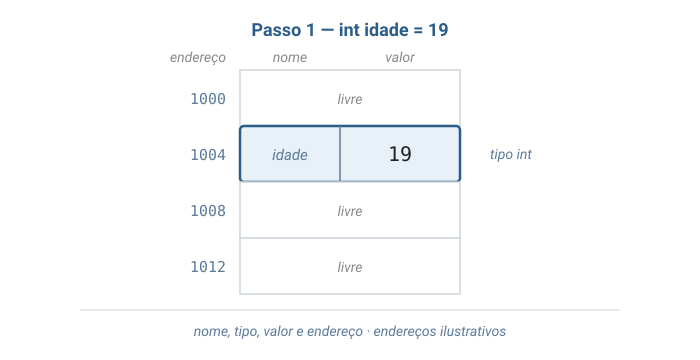

A variável `idade` ocupa a posição de endereço `1004` e guarda o valor `19`.
O nome, o tipo, o valor e o endereço são as quatro características de toda variável.

### Passo 2: int *p = &idade

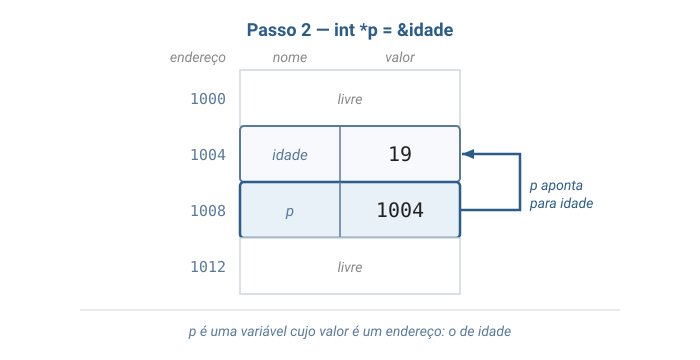

O ponteiro `p` também ocupa uma posição (`1008`), mas o valor que ele guarda é um endereço: `1004`, o de `idade`.
A seta é a forma gráfica de ler "p aponta para idade".

### Passo 3: *p = 20

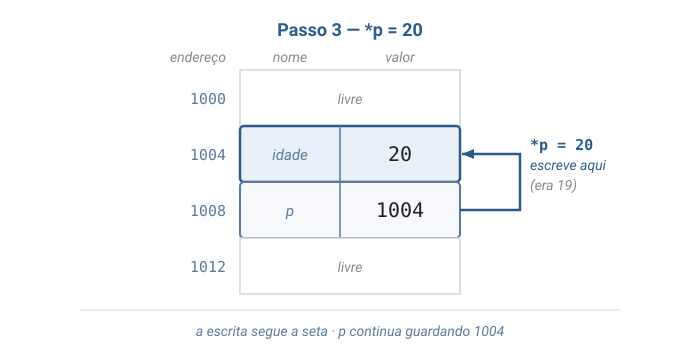

A atribuição `*p = 20` segue a seta e escreve em `idade`, que passa a valer `20`.
O ponteiro `p` não mudou: continua guardando `1004`.

### Passo 4: trocar_por_valor(a, b)

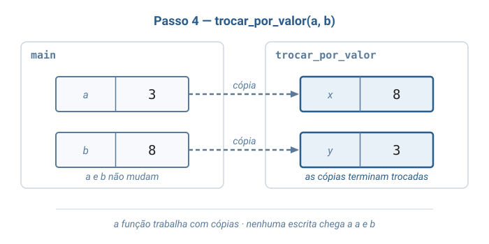

A função recebe **cópias**: os parâmetros `x` e `y` começam com `3` e `8` e terminam trocados.
As variáveis `a` e `b` continuam valendo `3` e `8`, porque nenhuma escrita chegou até elas.

### Passo 5: trocar(&a, &b)

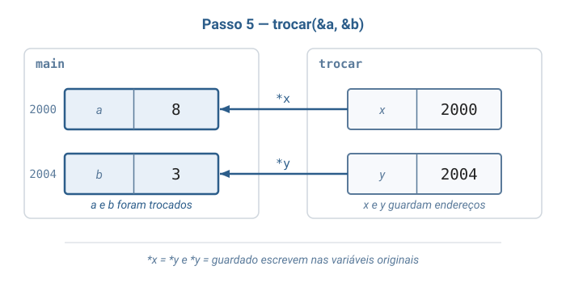

Agora os parâmetros guardam os **endereços** de `a` e `b`.
As escritas seguem as setas e alteram as variáveis originais: `a` passa a `8` e `b` passa a `3`.

### Passo 6: valores = malloc(3 * sizeof(int))

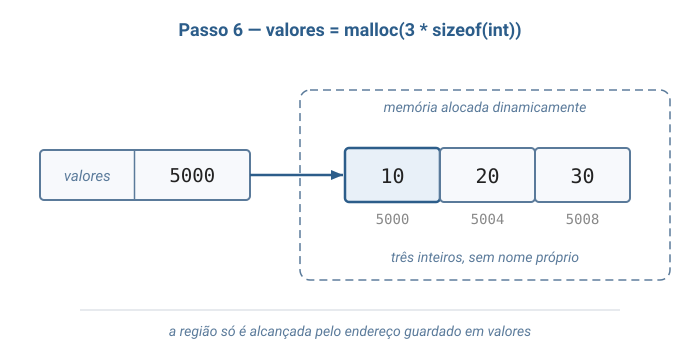

`malloc` reservou uma região para três inteiros e devolveu o endereço do início, guardado em `valores`.
A região não tem nome próprio: ela só é alcançável por meio de `valores`.

### Passo 7: free(valores); valores = NULL

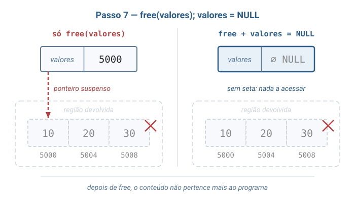

`free` devolveu a região, que deixou de pertencer ao programa.
Sem a segunda instrução, `valores` continuaria guardando o endereço antigo — um ponteiro suspenso; com `valores = NULL`, o ponteiro passa a dizer que não aponta para nada.

### Passo 8: Aluno aluno, com os campos preenchidos pelo ponto

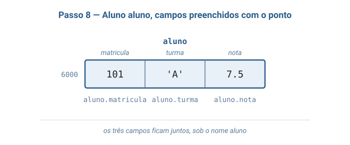

Os três campos do registro ficam juntos na memória, sob o nome `aluno`, e cada um é acessado pelo operador ponto.

### Passo 9: Aluno *pa = &aluno; pa->nota = 8.0

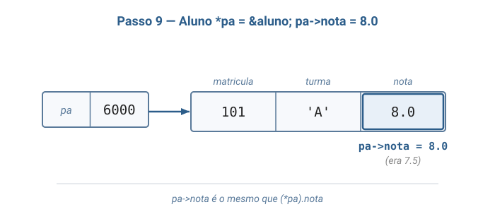

O ponteiro `pa` guarda o endereço do registro inteiro.
A expressão `pa->nota` segue a seta e escolhe o campo `nota`, que passa de `7.5` para `8.0`.

### Passo 10: aluno_aplicar_bonus(&aluno, 1.5)

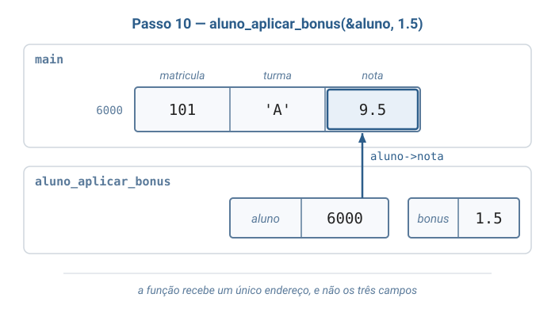

A função recebeu apenas o endereço do registro — um único valor, qualquer que seja o número de campos.
Pelo operador seta, ela alterou a nota do registro original, que passou a `9.5`.

### Passo 11: novo = aluno_criar(102, 'B', 6.0)

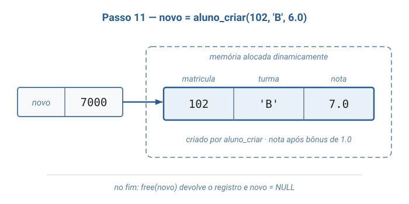

`aluno_criar` reservou o registro com `malloc`, preencheu os campos e devolveu o endereço, guardado em `novo`; em seguida, um bônus de `1.0` levou a nota a `7.0`.
No fim, `free(novo)` devolve o registro e `novo = NULL` impede que o endereço antigo seja usado.

---

## 3. Problema Motivador

> *"Como o `scanf` consegue guardar o número digitado dentro da minha variável?"*

Todo programa C que lê dados do teclado escreve algo como `scanf("%d", &idade);`, e o `&` costuma ser memorizado antes de ser entendido.
A explicação é a passagem por valor: se a chamada fosse `scanf("%d", idade)`, a função receberia apenas uma **cópia** do valor atual de `idade`, e o número digitado ficaria nessa cópia, perdido ao fim da chamada.
Com `&idade`, a função recebe o **endereço** da variável e escreve diretamente nela — exatamente como `trocar(&a, &b)` altera `a` e `b`.
Por contraste, `printf("%d", idade)` não precisa do `&`, porque só lê o valor, e para ler uma cópia basta.

O mesmo mecanismo sustenta um sistema de cadastro escolar, que precisa guardar dados de tipos diferentes para cada aluno e não sabe, quando o programa é escrito, quantos alunos haverá.
A struct `Aluno` agrupa os dados de cada aluno num registro só; `malloc` cria cada registro no momento em que ele é necessário; funções como `aluno_aplicar_bonus` recebem o endereço do registro e o alteram sem copiá-lo; e `free` devolve a memória de cada registro que deixa de ser útil.

---

## 4. Código em C

O programa percorre os conceitos da aula na mesma ordem da visualização: cada função `demonstrar_...` isola um conceito e imprime o que acontece, e a `main()` apenas chama as demonstrações em sequência.

> **Sobre a organização do arquivo.** Tudo o que vem a seguir vive em **um único arquivo** chamado `ponteiros_structs.c`: `#include`s, a struct, as funções e a `main()` demonstrativa. Manter tudo num arquivo só permite ler o programa inteiro de cima a baixo, sem saltar entre arquivos.

### `ponteiros_structs.c` — arquivo único

```c
#include <stdio.h>
#include <stdlib.h>

// Um Aluno agrupa, sob um unico nome, dados de tipos diferentes.
typedef struct Aluno {
    int matricula;
    char turma;
    double nota;
} Aluno;

// Recebe COPIAS dos valores de quem chamou. Trocar x e y aqui dentro
// nao altera as variaveis originais.
void trocar_por_valor(int x, int y) {
    int guardado = x;
    x = y;
    y = guardado;
}

// Recebe os ENDERECOS das variaveis de quem chamou. Escrevendo em *x e *y,
// a funcao altera as variaveis originais.
void trocar(int *x, int *y) {
    int guardado = *x;
    *x = *y;
    *y = guardado;
}

// Recebe uma COPIA do aluno: basta para ler os campos, nao para altera-los.
void aluno_imprimir(Aluno aluno) {
    printf("matricula %d, turma %c, nota %.1f\n",
           aluno.matricula, aluno.turma, aluno.nota);
}

// Recebe o ENDERECO do aluno, para que a alteracao valha no registro
// original de quem chamou, e nao numa copia.
void aluno_aplicar_bonus(Aluno *aluno, double bonus) {
    aluno->nota = aluno->nota + bonus;
}

// Cria um Aluno em memoria alocada dinamicamente. Diferente de uma variavel
// declarada dentro da funcao, esse registro continua existindo depois
// que a funcao termina, ate que alguem chame free.
Aluno *aluno_criar(int matricula, char turma, double nota) {
    Aluno *novo = malloc(sizeof(Aluno));
    if (novo == NULL) {
        printf("erro: memoria insuficiente\n");
        exit(1);
    }
    novo->matricula = matricula;
    novo->turma = turma;
    novo->nota = nota;
    return novo;
}

// Um ponteiro guarda o endereco de outra variavel e, por ele,
// e possivel ler e alterar essa variavel.
void demonstrar_ponteiro(void) {
    int idade = 19;
    int *p = &idade;   // p recebe o endereco de idade

    printf("idade = %d, *p = %d\n", idade, *p);
    printf("p == &idade vale %d\n", p == &idade);

    *p = 20;           // escreve na variavel idade passando pelo ponteiro
    printf("depois de *p = 20, idade = %d\n", idade);
}

// So a versao que recebe enderecos consegue trocar os valores de a e b.
void demonstrar_troca(void) {
    int a = 3;
    int b = 8;

    trocar_por_valor(a, b);
    printf("depois de trocar_por_valor(a, b): a = %d, b = %d\n", a, b);

    trocar(&a, &b);
    printf("depois de trocar(&a, &b): a = %d, b = %d\n", a, b);
}

// A quantidade de valores so e conhecida durante a execucao, entao a
// memoria e pedida com malloc e devolvida com free.
void demonstrar_alocacao(int quantidade) {
    int *valores = malloc(quantidade * sizeof(int));
    if (valores == NULL) {
        printf("erro: memoria insuficiente\n");
        exit(1);
    }

    for (int i = 0; i < quantidade; i++) {
        valores[i] = (i + 1) * 10;
    }
    printf("valores alocados:");
    for (int i = 0; i < quantidade; i++) {
        printf(" %d", valores[i]);
    }
    printf("\n");

    free(valores);    // devolve a memoria; o conteudo deixa de ser nosso
    valores = NULL;   // assim valores nao guarda mais um endereco invalido
}

// Campos acessados pelo ponto, pelo ponteiro com seta e por uma funcao
// que recebe o endereco do registro.
void demonstrar_struct(void) {
    Aluno aluno;
    aluno.matricula = 101;
    aluno.turma = 'A';
    aluno.nota = 7.5;
    aluno_imprimir(aluno);

    Aluno *pa = &aluno;
    pa->nota = 8.0;    // o mesmo que (*pa).nota = 8.0
    aluno_imprimir(aluno);

    aluno_aplicar_bonus(&aluno, 1.5);
    aluno_imprimir(aluno);
}

// Um aluno criado dinamicamente existe ate que free o devolva.
void demonstrar_struct_dinamica(void) {
    Aluno *novo = aluno_criar(102, 'B', 6.0);
    aluno_aplicar_bonus(novo, 1.0);
    aluno_imprimir(*novo);

    free(novo);       // devolve o registro criado por aluno_criar
    novo = NULL;
}

int main(void) {
    printf("== Ponteiro ==\n");
    demonstrar_ponteiro();

    printf("\n== Passagem por valor e por referencia ==\n");
    demonstrar_troca();

    printf("\n== Alocacao dinamica ==\n");
    demonstrar_alocacao(3);

    printf("\n== Struct ==\n");
    demonstrar_struct();

    printf("\n== Struct alocada dinamicamente ==\n");
    demonstrar_struct_dinamica();

    return 0;
}
```

### Compilando e rodando

```sh
gcc -Wall -Wextra -o ponteiros_structs ponteiros_structs.c
./ponteiros_structs
```

Saída esperada:

```
== Ponteiro ==
idade = 19, *p = 19
p == &idade vale 1
depois de *p = 20, idade = 20

== Passagem por valor e por referencia ==
depois de trocar_por_valor(a, b): a = 3, b = 8
depois de trocar(&a, &b): a = 8, b = 3

== Alocacao dinamica ==
valores alocados: 10 20 30

== Struct ==
matricula 101, turma A, nota 7.5
matricula 101, turma A, nota 8.0
matricula 101, turma A, nota 9.5

== Struct alocada dinamicamente ==
matricula 102, turma B, nota 7.0
```

Em C, uma comparação verdadeira vale `1` e uma falsa vale `0`; por isso a linha `p == &idade vale 1` confirma que `p` guarda o endereço de `idade`.
O programa não imprime endereços de propósito: eles mudam a cada execução, e a saída não poderia ser comparada.

### Conferindo a memória

O próprio compilador oferece um verificador que detecta, durante a execução, acessos a memória inválida:

```sh
gcc -Wall -Wextra -g -fsanitize=address -o ponteiros_structs ponteiros_structs.c
./ponteiros_structs
```

Se a saída for a mesma de antes, sem nenhum relatório de erro, nenhum acesso inválido aconteceu.
Vale testar o verificador inserindo de propósito um erro — por exemplo, `printf("%d\n", valores[0]);` logo depois do `free(valores)` — e ler o relatório que ele produz.

---

## 5. Referências

1. **Cormen, T. H.; Leiserson, C. E.; Rivest, R. L.; Stein, C.** — *Algoritmos: Teoria e Prática*. Capítulo 2, convenções de pseudocódigo — objetos, atributos, ponteiros e o valor NIL, que correspondem à struct, ao campo e ao `NULL` de C. Capítulo 10, *Estruturas de dados elementares* — objetos e ponteiros como matéria-prima das estruturas de dados.
2. **Backes, A. R.** — *Algoritmos e Estruturas de Dados em Linguagem C* (LTC, 2023). Capítulos de ponteiros, alocação dinâmica e estruturas.
3. **Veloso, P.; Pereira, S. do L.** — *Estruturas de Dados em C — Uma Abordagem Didática* (Saraiva, 2016). Trechos sobre ponteiros e registros.
4. **Toscani, L. V.; Veloso, P. A. S.** — *Complexidade de Algoritmos* (Bookman, 2012). Capítulo introdutório de análise — o custo constante do acesso por endereço.
5. **Schildt, H.** — *C Completo e Total* (Makron Books, 1997). Capítulos de ponteiros, de estruturas e de alocação dinâmica.

**Leituras complementares**:

- **Damas, L.** — *Linguagem C* (10ª ed., LTC, 2023) — ponteiros e estruturas em profundidade.
- **Wirth, N.** — *Algoritmos e Estruturas de Dados* (LTC, 1999) — o registro como tipo estruturado, na visão clássica.
- **Jamsa, K.; Klander, L.** — *Programando em C/C++: a bíblia* (Pearson, 1999) — referência adicional de C, com muitos exemplos curtos.
