# Aula 07 — Listas Encadeadas, Pilhas e Filas (Linked Lists, Stacks and Queues)

> **Tipo desta aula**: implementação. As três estruturas são construídas com a mesma peça, o **nó**, e diferem apenas nos ponteiros externos que guardam e na extremidade em que operam. Representação escolhida: **lista simplesmente encadeada** — a lista guarda o ponteiro `inicio`, a pilha guarda `topo` e a fila guarda `inicio` e `fim`.

---

## 1. Conceito — Aprofundamento Progressivo

### Camada 1 — Introdução

Imagine uma caça ao tesouro. A primeira pista fica num lugar combinado, e cada pista diz apenas onde encontrar a seguinte. As pistas podem estar espalhadas pela casa inteira, em qualquer ordem física, e ainda assim formam uma sequência — porque cada uma indica onde está a próxima. Para chegar à quinta pista, porém, não há atalho: é preciso passar pelas quatro primeiras. Sobre essa mesma corrente de pistas ainda é possível impor uma regra de uso: retirar sempre a pista guardada por último, ou sempre a que está guardada há mais tempo.

### Camada 2 — Definição informal com vocabulário básico

Uma **lista encadeada** (em inglês, *linked list*) é uma sequência de elementos em que cada elemento, chamado **nó** (*node*), guarda duas informações: o **valor** armazenado e a indicação de onde está o **próximo** nó. O primeiro nó é alcançado por uma referência externa, o **início** da lista (*head*). O último nó registra que não existe próximo. Cormen et al. chamam essa estrutura de **lista ligada** e a apresentam entre as estruturas de dados elementares (Cormen et al., *Algoritmos: Teoria e Prática*, cap. 10, seção 10.2). Backes e Veloso & Pereira tratam a mesma estrutura, já implementada em C, nos capítulos de listas.

A diferença para o **vetor** está na organização física. No vetor, os elementos ocupam posições vizinhas da memória, e o elemento de índice *i* é localizado diretamente por um cálculo. Na lista encadeada, cada nó pode estar em qualquer lugar da memória; a ordem da sequência é dada pelas ligações, não pela posição. Em troca, a lista não precisa conhecer de antemão quantos elementos terá: ela cresce e diminui um nó de cada vez.

A lista oferece quatro operações fundamentais:

- **percorrer** (*traverse*) — visitar os nós do primeiro ao último, seguindo as ligações;
- **buscar** (*search*) — encontrar o nó que contém um valor;
- **inserir** (*insert*) — acrescentar um nó, no início ou no fim da sequência;
- **remover** (*delete*) — retirar um nó e religar os seus vizinhos.

Duas estruturas muito usadas surgem quando se **restringe** onde uma lista pode receber e perder elementos. Cormen et al. as descrevem como **conjuntos dinâmicos** — coleções que crescem e diminuem durante a execução do programa — nos quais o elemento removido é predeterminado: na pilha, é o inserido mais recentemente; na fila, é o que está no conjunto há mais tempo (cap. 10, seção 10.1).

- Uma **pilha** (*stack*) insere e remove sempre na mesma extremidade, chamada **topo** (*top*). Essa política recebe o nome **LIFO** (*Last-In, First-Out*): o último a entrar é o primeiro a sair. Suas operações são **empilhar** (*push*), **desempilhar** (*pop*), **consultar o topo** e **vazia**.
- Uma **fila** (*queue*) insere numa extremidade, o **fim** (*tail*), e remove na outra, o **início**, também chamado **frente** (*front*). Essa política recebe o nome **FIFO** (*First-In, First-Out*): o primeiro a entrar é o primeiro a sair. Suas operações são **enfileirar** (*enqueue*), **desenfileirar** (*dequeue*), **consultar a frente** e **vazia**.

Note o que a pilha e a fila **não** oferecem: não é possível ler o terceiro elemento, inserir no meio nem remover um elemento qualquer. A restrição é deliberada. Ao limitar o acesso às extremidades, cada operação passa a custar um número fixo de passos, e a ordem de saída fica garantida pela própria estrutura, sem depender do cuidado de quem a usa.

### Camada 3 — Propriedades e comportamento

#### Os fundamentos que esta aula usa

Construir uma lista encadeada em C exige três recursos da linguagem: o **ponteiro**, o **registro** (`struct`) e a **alocação dinâmica** de memória. Cada um é apresentado aqui no nível que a aula exige (Schildt, *C Completo e Total*, capítulos sobre ponteiros, estruturas e alocação dinâmica).

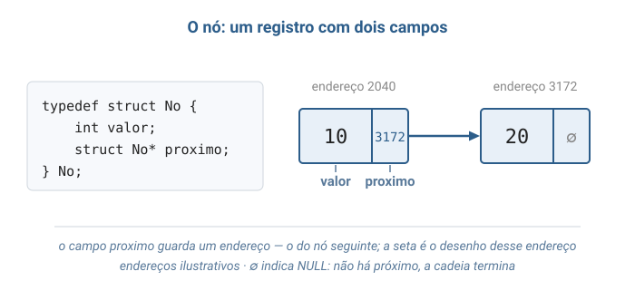

**Endereço e ponteiro.** A memória do computador pode ser imaginada como uma longa sequência de posições numeradas; o número de cada posição é o seu **endereço**. Toda variável ocupa alguma posição e, portanto, tem um endereço. Um **ponteiro** é uma variável cujo conteúdo é um endereço: ele não guarda o dado, guarda a indicação de onde o dado está. Em C, o operador `&` obtém o endereço de uma variável, e o operador `*` acessa o conteúdo que está no endereço guardado.

```c
int idade = 19;
int* ponteiro = &idade;   /* ponteiro guarda o endereco de idade */
*ponteiro = 20;           /* altera idade por meio do endereco: idade passa a valer 20 */
```

O valor especial `NULL` representa "endereço nenhum": um ponteiro igual a `NULL` não indica posição alguma. No pseudocódigo de Cormen et al., o mesmo papel é desempenhado pelo valor NIL.

**Registro (`struct`).** Um **registro** agrupa, sob um único nome, variáveis relacionadas, chamadas **campos**. O nó da lista é um registro com dois campos:

```c
typedef struct No {
    int valor;            /* o dado armazenado */
    struct No* proximo;   /* o endereco do no seguinte, ou NULL */
} No;
```

Quando se tem um ponteiro `p` para um nó, o operador `->` acessa os seus campos: `p->valor` é o valor do nó apontado por `p`, e `p->proximo` é o endereço do nó seguinte. A palavra `typedef` apenas dá o nome curto `No` ao tipo `struct No`.

**A autorreferência.** O campo `proximo` é um ponteiro para outro registro **do mesmo tipo** que o registro que o contém. Um registro que se refere ao próprio tipo chama-se **autorreferenciado**, e é essa propriedade que permite encadear nós. O campo precisa ser um **ponteiro**, e não um nó. Se ele fosse declarado como `struct No proximo`, cada nó conteria um nó inteiro, que conteria outro nó inteiro, sem fim: o registro teria tamanho infinito, e o compilador rejeita essa definição com um erro de tipo incompleto. Um ponteiro, ao contrário, tem sempre o mesmo tamanho — o de um endereço —, qualquer que seja o tamanho do registro apontado.

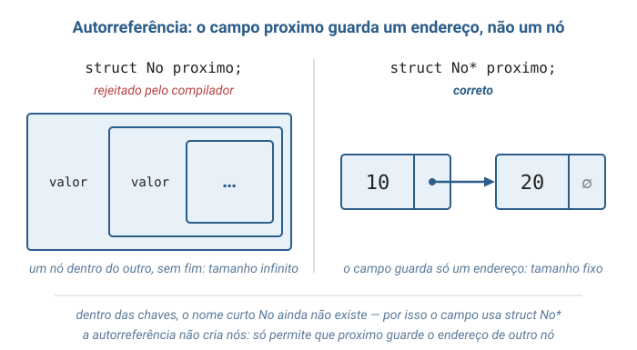

Dois detalhes completam a definição. Primeiro, dentro das chaves o campo é escrito com o nome completo, `struct No*`, porque o nome curto `No` só passa a existir na última linha, quando o `typedef` termina. Segundo, a autorreferência não cria nenhum nó: ela apenas permite que o campo `proximo` guarde o endereço de outro nó, ou `NULL`. As ligações entre nós são feitas depois, por atribuições.

**Alocação dinâmica.** O número de nós de uma lista não é conhecido quando o programa é escrito: ele varia durante a execução. Por isso cada nó é criado sob demanda com `malloc`, que reserva a quantidade de bytes pedida e devolve o endereço reservado — ou `NULL`, quando não há memória disponível. Quando o nó deixa de ser necessário, `free` devolve aquela memória. A partir do `free`, o endereço não pode mais ser usado. Um ponteiro que ainda guarda um endereço já liberado chama-se **ponteiro suspenso** (*dangling pointer*), e usá-lo é um erro grave.

```c
No* novo = malloc(sizeof(No));  /* reserva espaco para um no; sizeof(No) e' o tamanho dele em bytes */
if (novo == NULL) {             /* a reserva pode falhar */
    printf("erro: memoria insuficiente\n");
    exit(1);
}
free(novo);                     /* devolve o espaco; a partir daqui, novo nao deve ser usado */
```

#### Ligar nós: a cadeia

Um nó recém-reservado não está ligado a nenhum outro: o seu campo `proximo` vale `NULL`. A ligação é feita por atribuições comuns, que copiam o endereço de um nó para o campo `proximo` de outro. O trecho abaixo usa a função `criar_no(valor)`, que reserva um nó com `malloc`, guarda o valor e deixa `proximo` igual a `NULL`; ela aparece no programa completo do bloco 4.

```c
No* primeiro = criar_no(10);
No* segundo = criar_no(20);
No* terceiro = criar_no(30);
primeiro->proximo = segundo;    /* o 10 passa a guardar o endereco do 20 */
segundo->proximo = terceiro;    /* o 20 passa a guardar o endereco do 30 */
```

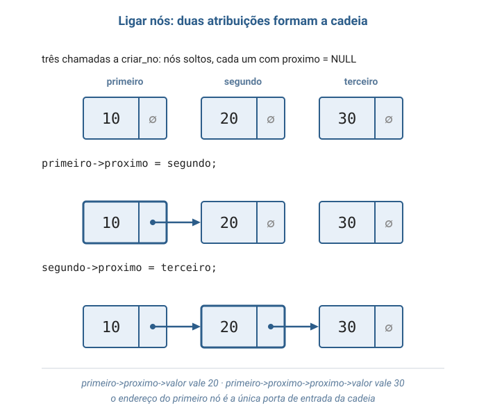

Depois das duas atribuições, os três nós formam uma sequência: o primeiro guarda o endereço do segundo, o segundo guarda o do terceiro, e o terceiro, com `proximo` igual a `NULL`, é o último. Esta aula chama de **cadeia** essa sequência de nós ligados. Fisicamente, cada nó continua onde o seu `malloc` o colocou; o que os organiza em sequência é apenas o campo `proximo`.

A partir do primeiro nó, a cadeia inteira é alcançável seguindo as ligações. A expressão `primeiro->proximo` é o endereço do segundo nó; portanto, `primeiro->proximo->valor` vale 20, e `primeiro->proximo->proximo->valor` vale 30. Cada `->proximo` avança um nó. O endereço do primeiro nó é a única porta de entrada da cadeia: perdido esse endereço, nenhum ponteiro leva mais aos três nós.

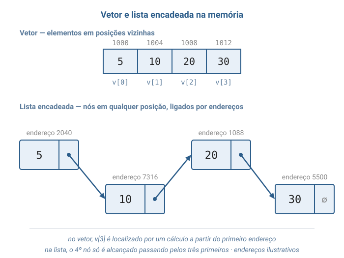

A comparação com o vetor mostra a consequência central da representação. No vetor, `v[3]` é encontrado por um cálculo a partir do endereço do primeiro elemento. Na lista, o quarto nó só é encontrado depois de visitar o primeiro, o segundo e o terceiro, porque apenas o terceiro conhece o endereço do quarto.

#### Liberar a cadeia inteira

Cada nó foi reservado por um `malloc` próprio e, por isso, precisa de um `free` próprio. Liberar apenas o primeiro nó não libera os demais: o segundo e o terceiro continuariam ocupando memória, agora sem nenhum ponteiro que leve até eles. Memória reservada que o programa não consegue mais alcançar — e que, portanto, nunca poderá liberar — chama-se **vazamento de memória** (*memory leak*). Num programa que executa por muito tempo, os vazamentos se acumulam até esgotar a memória disponível.

A liberação percorre a cadeia com um cuidado que o percurso comum não exige: o endereço do nó seguinte precisa ser guardado **antes** do `free` do nó atual. Depois do `free`, o campo `atual->proximo` pertence a uma memória já devolvida e não pode mais ser lido — lê-lo seria usar um ponteiro suspenso.

```c
void liberar_cadeia(No* primeiro) {
    No* atual = primeiro;
    while (atual != NULL) {
        No* seguinte = atual->proximo;   /* 1: guarda o endereco do proximo no */
        free(atual);                     /* 2: devolve o no atual */
        atual = seguinte;                /* 3: avanca pelo endereco guardado */
    }
}
```

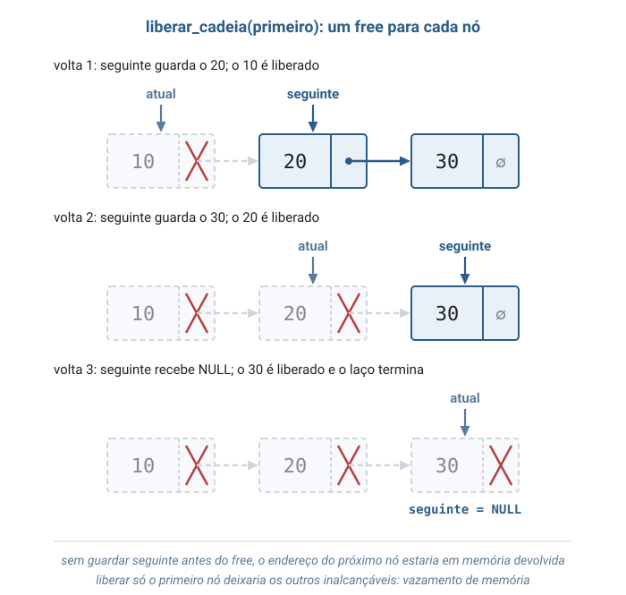

A figura acompanha as três voltas do laço sobre a cadeia 10 → 20 → 30. A cada volta, `seguinte` recebe o endereço do próximo nó, o nó atual é liberado e `atual` avança para o endereço guardado. Quando `atual` fica `NULL`, os três nós foram devolvidos. O custo é **O(n)**: um `free` por nó. A lista, a pilha e a fila desta aula usam essa mesma função para se destruir.

#### Os ponteiros externos: o que cada estrutura guarda

A cadeia sozinha é inalcançável: algum ponteiro, fora dos nós, precisa guardar o endereço do primeiro nó. As três estruturas desta aula diferem exatamente nesse ponto.

- A **lista** guarda `inicio`, o endereço do primeiro nó.
- A **pilha** guarda `topo`. O topo é o primeiro nó da cadeia, e é ali que empilhar e desempilhar acontecem.
- A **fila** guarda `inicio` e `fim`. Remove-se pelo início; insere-se depois do último nó, e o ponteiro `fim` evita percorrer a cadeia inteira para encontrá-lo.

Por que o topo da pilha fica no início da cadeia, e não no fim? Porque o início é a única extremidade em que tanto inserir quanto remover custam um número fixo de passos. No fim, inserir é barato quando existe o ponteiro `fim`; remover, porém, exigiria encontrar o penúltimo nó, que só é alcançado percorrendo a cadeia desde o início. A mesma razão explica por que a fila remove pelo início e insere pelo fim, e não o contrário.

#### As operações da lista em detalhe

- **Percorrer.** Um ponteiro auxiliar `atual` começa em `inicio`. A cada passo, o nó apontado é processado e `atual` avança com `atual = atual->proximo`. O percurso termina quando `atual` fica `NULL`. Custo: **O(n)**, sendo *n* o número de nós.
- **Buscar(valor).** Percorre a cadeia comparando cada `valor` com o procurado. Devolve o endereço do primeiro nó igual, ou `NULL` se chegar ao fim sem encontrar. A ordem do teste `atual != NULL && atual->valor != valor` é obrigatória: primeiro se confirma que `atual` existe, só depois se lê `atual->valor`. Custo: **O(n)** no pior caso.
- **Inserir no início.** Dois passos, nesta ordem: o novo nó passa a apontar para o antigo primeiro (`novo->proximo = inicio`); depois, `inicio` passa a apontar para o novo nó. Invertida a ordem, o endereço do antigo primeiro se perderia — e, com ele, toda a cadeia. A operação funciona também com a lista vazia: o novo nó simplesmente recebe `NULL` como próximo. Custo: **O(1)**.
- **Inserir no fim (lista sem ponteiro `fim`).** Se a lista está vazia, o novo nó passa a ser o primeiro. Caso contrário, é preciso caminhar até o nó cujo `proximo` é `NULL` e ligá-lo ao novo nó. Custo: **O(n)**, pois a caminhada visita todos os nós.
- **Remover(valor).** A busca é feita com dois ponteiros lado a lado, `anterior` e `atual`, porque desligar `atual` exige alterar o campo `proximo` do nó que vem antes dele. Encontrado o valor, a cadeia é religada **antes** da liberação: se o nó é o primeiro (`anterior == NULL`), `inicio` avança; caso contrário, `anterior->proximo` passa a apontar para `atual->proximo`. Só então se chama `free(atual)`. Se o valor não existe, a lista permanece intacta. Custo: **O(n)** no pior caso, dominado pela busca; a religação em si custa O(1).

#### As operações da pilha em detalhe

- **Empilhar(valor).** Os mesmos dois passos de inserir no início, com `topo` no papel de `inicio`: o novo nó aponta para o antigo topo e passa a ser o topo. Custo: **O(1)**.
- **Desempilhar().** Guarda o endereço do nó do topo, lê o seu valor, faz `topo` descer para `topo->proximo` e só então libera o nó. A ordem importa: liberar primeiro deixaria `topo` como ponteiro suspenso. Pré-condição: a pilha não pode estar vazia. Custo: **O(1)**.
- **Consultar o topo.** Devolve `topo->valor` sem alterar a pilha. Custo: **O(1)**.
- **Vazia.** Testa se `topo == NULL`. Custo: **O(1)**.

#### As operações da fila em detalhe

- **Enfileirar(valor).** O novo nó é criado com `proximo = NULL`, pois será o último. Se a fila está vazia, ele é ao mesmo tempo o primeiro e o último, e `inicio` passa a apontar para ele. Caso contrário, o antigo último é ligado ao novo (`fim->proximo = novo`). Nos dois casos, `fim` passa a apontar para o novo nó. Custo: **O(1)**.
- **Desenfileirar().** Guarda o endereço do primeiro nó, lê o seu valor e faz `inicio` avançar. Se `inicio` ficou `NULL`, a fila esvaziou, e `fim` também precisa receber `NULL`: ele ainda apontaria para o nó que está prestes a ser liberado. Esse é o único caso especial da fila. Pré-condição: a fila não pode estar vazia. Custo: **O(1)**.
- **Consultar a frente.** Devolve `inicio->valor` sem alterar a fila. Custo: **O(1)**.
- **Vazia.** Testa se `inicio == NULL`. Custo: **O(1)**.

#### Invariantes (propriedades que devem sempre valer)

Uma **invariante** é uma propriedade da estrutura que precisa ser verdadeira antes e depois de toda operação. Cada operação pode desfazê-la temporariamente durante a sua execução, mas deve restaurá-la antes de terminar.

- **Na lista**, seguindo os campos `proximo` a partir de `inicio`, chega-se a um nó cujo `proximo` é `NULL` depois de visitar exatamente os *n* nós. A lista está vazia se, e somente se, `inicio` é `NULL`.
- **Na pilha**, `topo` é `NULL` se, e somente se, a pilha está vazia. Quando não está vazia, o nó apontado por `topo` contém o elemento empilhado mais recentemente entre os que ainda estão na pilha.
- **Na fila**, `inicio` e `fim` são `NULL` ao mesmo tempo, ou nenhum dos dois é. Quando a fila não está vazia, o nó apontado por `fim` tem `proximo` igual a `NULL` e é alcançado seguindo a cadeia a partir de `inicio`.

A invariante da fila explica o seu caso especial. Sem a linha que zera `fim` quando a fila esvazia, `inicio` seria `NULL` e `fim` não — e o próximo enfileirar escreveria no campo `proximo` de um nó já liberado.

### Camada 4 — Definição formal e notação

Um **TAD** (Tipo Abstrato de Dados) define uma estrutura pelo seu **contrato observável**: os valores que ela armazena, as operações que oferece e os **axiomas** — igualdades que essas operações sempre satisfazem —, sem se comprometer com nenhuma representação interna. O mesmo TAD pode ser implementado com vetor ou com lista encadeada; o contrato não muda (Veloso & Pereira, capítulo de tipos abstratos de dados).

#### O TAD Pilha

```
TAD Pilha de Inteiros

  Operações:
    criar()                     -> Pilha
    empilhar(Pilha, Inteiro)    -> Pilha
    desempilhar(Pilha)          -> Pilha       [erro se vazia]
    topo(Pilha)                 -> Inteiro     [erro se vazia]
    vazia(Pilha)                -> Booleano

  Axiomas (para qualquer pilha P e inteiro x):
    A1. vazia(criar())                  = verdadeiro
    A2. vazia(empilhar(P, x))           = falso
    A3. topo(empilhar(P, x))            = x
    A4. desempilhar(empilhar(P, x))     = P
    A5. topo(criar())                   = erro
    A6. desempilhar(criar())            = erro
```

Os axiomas **A3 e A4** são o coração da política LIFO. A3 diz que o elemento visível logo após um empilhar é exatamente o que acabou de entrar. A4 diz que desempilhar desfaz o último empilhar e devolve a pilha exatamente ao estado anterior. No TAD, ler e remover são operações separadas (`topo` e `desempilhar`); no código C desta aula, `pilha_desempilhar` faz as duas coisas, removendo o nó e devolvendo o seu valor.

#### O TAD Fila

```
TAD Fila de Inteiros

  Operações:
    criar()                     -> Fila
    enfileirar(Fila, Inteiro)   -> Fila
    desenfileirar(Fila)         -> Fila        [erro se vazia]
    frente(Fila)                -> Inteiro     [erro se vazia]
    vazia(Fila)                 -> Booleano

  Axiomas (para qualquer fila F e inteiro x):
    A1. vazia(criar())                       = verdadeiro
    A2. vazia(enfileirar(F, x))              = falso
    A3. frente(enfileirar(F, x))             = x                                 se vazia(F)
                                             = frente(F)                         caso contrário
    A4. desenfileirar(enfileirar(F, x))      = criar()                           se vazia(F)
                                             = enfileirar(desenfileirar(F), x)   caso contrário
    A5. frente(criar())                      = erro
    A6. desenfileirar(criar())               = erro
```

Os axiomas **A3 e A4** são o coração da política FIFO. A3 diz que um elemento recém-chegado só aparece na frente se a fila estava vazia; caso contrário, a frente continua a mesma. A4 diz que remover da frente e acrescentar no fim são operações que não interferem uma na outra quando há alguém esperando: quem chegou antes sai antes.

#### A representação interna como tupla

A representação escolhida pode ser descrita por tuplas — listas ordenadas de componentes — que registram tudo o que define cada estrutura:

`L = (N, valor, proximo, inicio)`  ·  `P = (N, valor, proximo, topo)`  ·  `F = (N, valor, proximo, inicio, fim)`

onde:

- **N** é o conjunto, possivelmente vazio, dos nós da estrutura.
- **valor: N → Inteiro** associa cada nó ao inteiro que ele armazena.
- **proximo: N → N ∪ {NULL}** associa cada nó ao nó seguinte na cadeia, ou a `NULL` quando o nó é o último.
- **inicio**, **topo** ∈ N ∪ {NULL} indicam o primeiro nó da cadeia, ou `NULL` quando não há nós.
- **fim** ∈ N ∪ {NULL} indica o último nó da cadeia da fila, ou `NULL` quando a fila está vazia.

As equivalências "lista vazia ⇔ `inicio` = NULL", "pilha vazia ⇔ `topo` = NULL" e "fila vazia ⇔ `inicio` = NULL ⇔ `fim` = NULL" ligam formalmente o estado lógico de cada estrutura ao estado físico dos seus ponteiros externos. O pseudocódigo de Cormen et al. descreve os mesmos nós como objetos com atributos, escritos com a notação de ponto, e usa NIL para indicar a ausência de nó; a notação desta aula, com `->` e `NULL`, é a da linguagem C.

### Camada 5 — Análise de complexidade

A análise conta quantos passos cada operação executa em função de *n*, o número de elementos armazenados. A notação **O(·)** descreve como esse número cresce quando *n* cresce: **O(1)** indica um número de passos que não depende de *n*; **O(n)** indica um número de passos proporcional a *n* — dobrar a quantidade de elementos dobra o trabalho no pior caso (Toscani & Veloso, *Complexidade de Algoritmos*; Cormen et al., cap. 10).

A primeira tabela compara a lista encadeada com o vetor nas operações de uma sequência genérica.

| Operação                          | Vetor (posições vizinhas)   | Lista encadeada                          |
|-----------------------------------|-----------------------------|------------------------------------------|
| Acessar o elemento da posição *i* | O(1)                        | O(n)                                     |
| Buscar um valor                   | O(n)                        | O(n)                                     |
| Inserir no início                 | O(n) — desloca todos        | **O(1)**                                 |
| Inserir no fim                    | O(1)*                       | O(n) sem `fim` · **O(1)** com `fim`      |
| Remover do início                 | O(n) — desloca todos        | **O(1)**                                 |
| Remover um valor qualquer         | O(n)                        | O(n)                                     |

\* *Enquanto houver espaço reservado no vetor. Esgotado o espaço, é preciso reservar um vetor maior e copiar todos os elementos para ele.*

A segunda tabela resume a pilha e a fila implementadas nesta aula.

| Operação   | Pilha (cadeia com `topo`) | Fila (cadeia com `inicio` e `fim`) |
|------------|---------------------------|------------------------------------|
| Inserir    | `empilhar` — **O(1)**     | `enfileirar` — **O(1)**            |
| Remover    | `desempilhar` — **O(1)**  | `desenfileirar` — **O(1)**         |
| Consultar  | `topo` — **O(1)**         | `frente` — **O(1)**                |
| Vazia      | **O(1)**                  | **O(1)**                           |

As duas tabelas mostram a troca que a representação encadeada faz. Ela perde o acesso direto por posição: o vetor encontra o décimo elemento com um cálculo; a lista precisa visitar nove nós antes. Em compensação, ela ganha as inserções e remoções nas extremidades em tempo constante, sem deslocar elementos, e cresce sem limite prévio. É exatamente o que pilha e fila precisam, porque elas só operam nas extremidades.

Há também um custo de memória. Cada nó ocupa, além do valor, um ponteiro — em computadores de 64 bits, 8 bytes por nó —, e cada inserção faz uma chamada a `malloc`. O vetor faz uma única reserva para todos os elementos. Cormen et al. implementam pilha e fila com vetores (seção 10.1), com capacidade fixa; esta aula usa a cadeia encadeada, que dispensa a capacidade fixa ao preço desse ponteiro extra por elemento. O livro também mostra que, numa lista em que cada nó guarda ainda o endereço do nó anterior, remover um nó cujo endereço já é conhecido custa O(1) (seção 10.2).

### Camada 6 — Conexões e variantes

As três estruturas aparecem em sistemas do dia a dia:

- **Desfazer (Ctrl+Z)** em editores de texto e de imagem — pilha de alterações.
- **Botão voltar** do navegador — pilha de páginas visitadas.
- **Verificação de parênteses, colchetes e chaves** em compiladores e editores de código — pilha de símbolos abertos.
- **Chamadas de função** durante a execução de um programa — a função chamada por último é a primeira a terminar.
- **Fila de impressão** e **atendimento por senha** — fila por ordem de chegada.
- **Teclas digitadas** que aguardam, na ordem em que foram pressionadas, a leitura pelo programa — fila.
- **Listas de reprodução** de músicas e **carrinhos de compra** — lista encadeada com inserções e remoções em qualquer ponto.

A representação também admite variantes. Na **lista duplamente encadeada**, cada nó guarda ainda o endereço do anterior, o que permite percorrer nos dois sentidos e remover um nó conhecido em O(1). Na **lista circular**, o último nó aponta de volta para o primeiro, útil quando os elementos são atendidos em rodízio. Cormen et al. descrevem ainda a lista com **sentinela**: um nó fictício, sem valor útil, colocado nas extremidades para eliminar os casos especiais de lista vazia e de primeiro nó (seção 10.2). A **fila dupla** (*deque*) permite inserir e remover nas duas extremidades. Pilhas e filas reaparecem como ferramentas nos algoritmos de percurso de árvores e de grafos, em que a escolha entre uma e outra decide a ordem em que os elementos são visitados.

---

## 2. Visualização Gráfica

A sequência acompanha o programa do bloco 4: primeiro a lista, depois a pilha, depois a fila. Nos diagramas, cada nó é uma caixa com duas partes — o valor, à esquerda, e o campo `proximo`, à direita. Uma seta sai do campo `proximo` e chega ao nó seguinte; o símbolo ∅ indica `NULL`.

### Passo 1: lista_criar()


A lista nasce sem nós. O único estado que existe é o ponteiro `inicio`, igual a `NULL`.

### Passo 2: lista_inserir_no_fim(lista, 10)


Com a lista vazia, o novo nó é ao mesmo tempo o primeiro e o último. Apenas `inicio` muda: passa a guardar o endereço do nó 10, cujo `proximo` é `NULL`.

### Passo 3: lista_inserir_no_fim(lista, 20)

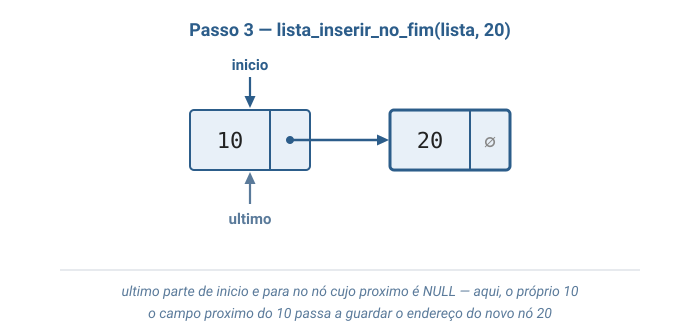

A lista só conhece o primeiro nó. O ponteiro auxiliar `ultimo` parte de `inicio` e avança até o nó cujo `proximo` é `NULL` — aqui, o próprio 10. O campo `proximo` do 10 passa a apontar para o novo nó 20.

### Passo 4: lista_inserir_no_inicio(lista, 5)

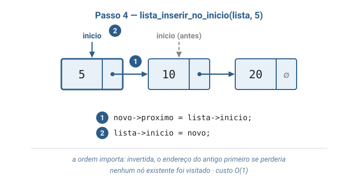

Dois passos, nesta ordem: ① o novo nó 5 aponta para o antigo primeiro (10); ② `inicio` passa a apontar para o 5. Nenhum nó existente foi visitado — por isso o custo não depende do tamanho da lista.

### Passo 5: lista_inserir_no_fim(lista, 30)

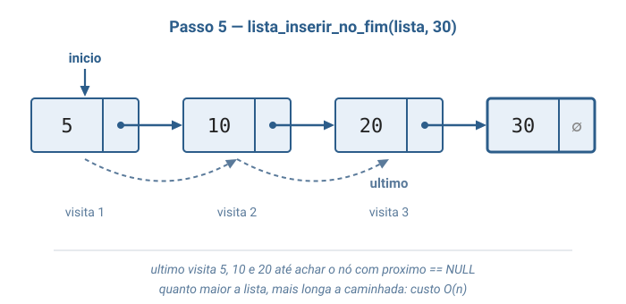

Agora a caminhada é visível: `ultimo` visita 5, 10 e 20 antes de encontrar o nó cujo `proximo` é `NULL`. Quanto maior a lista, mais longa a caminhada — é o custo O(n) da inserção no fim sem um ponteiro para o último nó.

### Passo 6: lista_buscar(lista, 20)

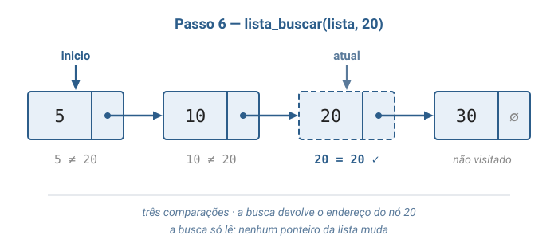

O ponteiro `atual` compara cada valor com 20: `5 ≠ 20`, `10 ≠ 20`, `20 = 20`. A busca devolve o endereço do terceiro nó. A lista não foi alterada. Uma busca por 99 visitaria os quatro nós e devolveria `NULL`.

### Passo 7: lista_remover(lista, 20)

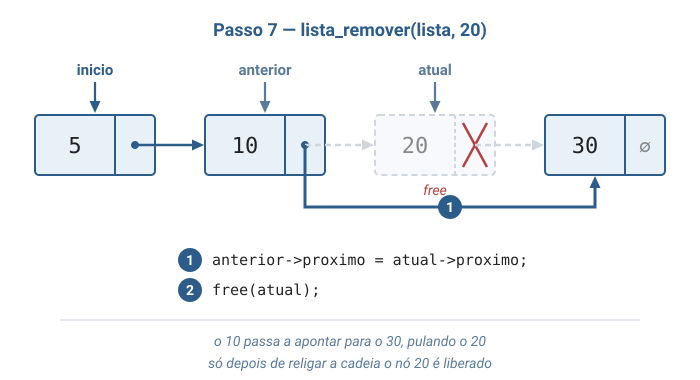

A busca termina com `anterior` no nó 10 e `atual` no nó 20. O 10 passa a apontar para o 30, "pulando" o 20. Só depois de religar a cadeia o nó 20 é liberado com `free`.

### Passo 8: lista_remover(lista, 5)

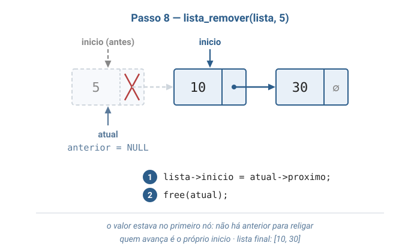

O valor procurado está no primeiro nó, e a busca termina com `anterior` igual a `NULL`. Não há nó anterior para religar: quem avança é o próprio `inicio`, que passa a apontar para o 10. A lista final é `[10, 30]`.

### Passo 9: pilha_empilhar(pilha, 30)

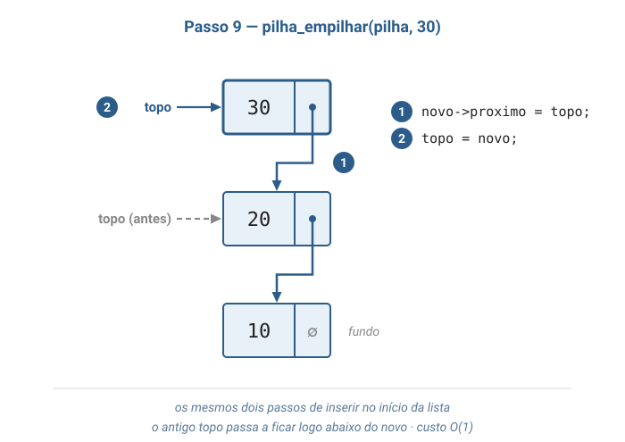

A pilha já contém 20 (no topo) e 10. Empilhar 30 repete os dois passos de inserir no início: ① o novo nó aponta para o antigo topo; ② `topo` passa a apontar para o 30. A cadeia é desenhada na vertical, com o topo em cima.

### Passo 10: pilha_desempilhar(pilha)

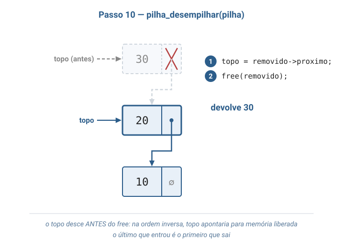

O valor 30 é lido e devolvido. O ponteiro `topo` desce para o 20 **antes** do `free` — é o último que entrou e o primeiro que sai.

### Passo 11: fila_enfileirar(fila, 30)

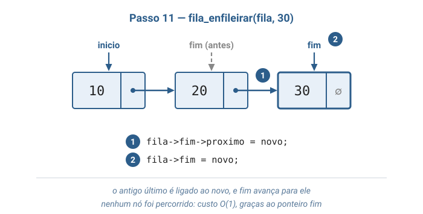

A fila já contém 10 (na frente) e 20 (no fim). O antigo último é ligado ao novo nó (`fim->proximo = novo`) e `fim` avança para ele. Graças ao ponteiro `fim`, nenhum nó foi percorrido: o custo é O(1).

### Passo 12: fila_desenfileirar(fila)

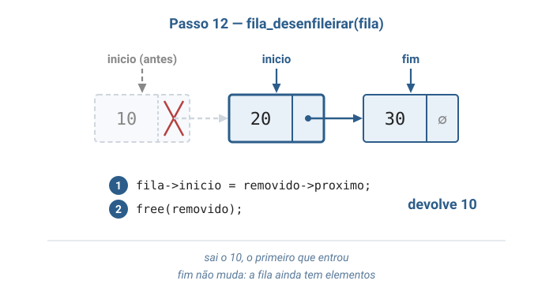

Sai o 10, o primeiro que entrou. `inicio` avança para o 20 e o nó 10 é liberado. O ponteiro `fim` não muda: a fila ainda tem elementos.

### Passo 13: fila_desenfileirar(fila) — o último elemento

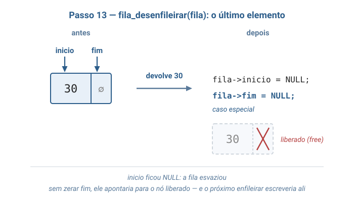

Depois de mais um desenfileirar, que devolve 20, resta só o 30. Ao removê-lo, `inicio` fica `NULL` e a fila esvazia. É o caso especial: `fim` ainda aponta para o nó 30, que está prestes a ser liberado, e por isso também recebe `NULL`.

### Passo 14: esvaziar a pilha e a fila

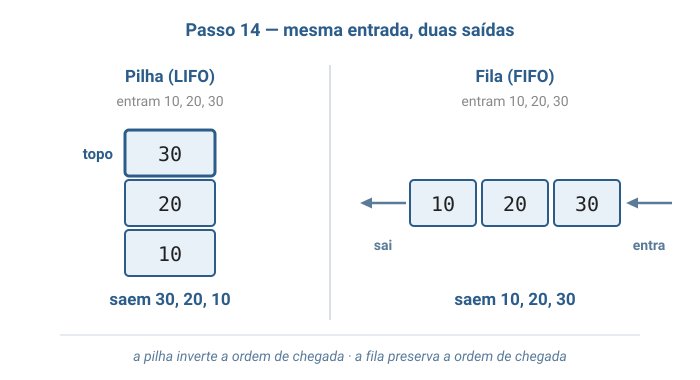

A mesma entrada — 10, 20, 30 — produz saídas opostas. A pilha devolve os valores na ordem inversa da chegada (LIFO); a fila devolve na mesma ordem (FIFO). É exatamente o que o programa do bloco 4 imprime.

---

## 3. Problema Motivador

> *"Como um editor de texto sabe o que desfazer, uma alteração de cada vez, quando você pressiona Ctrl+Z repetidas vezes?"*

Enquanto uma pessoa escreve, o editor registra cada alteração: um trecho digitado, uma palavra apagada, uma formatação aplicada. O primeiro Ctrl+Z desfaz a alteração **mais recente**; o segundo desfaz a anterior a ela; e assim por diante. A ordem de desfazer é o inverso da ordem de fazer. Essa é a política LIFO, e a estrutura que a implementa é a pilha: cada alteração é **empilhada** assim que acontece, e cada Ctrl+Z **desempilha** a alteração do topo e a reverte.

A representação encadeada é a escolha natural para essa pilha. O editor não sabe quantas alterações a pessoa fará: podem ser dez ou dez mil. Um vetor exigiria fixar um limite ou, ao atingi-lo, reservar um vetor maior e copiar todas as alterações já registradas. A cadeia de nós cresce um nó por alteração, e empilhar e desempilhar custam O(1) independentemente de quantas alterações já foram guardadas.

O mesmo nó, usado com a regra oposta, resolve um segundo problema: *como uma impressora compartilhada decide qual documento imprimir primeiro?* Os documentos chegam em momentos imprevisíveis, enviados por pessoas diferentes, e devem ser impressos por ordem de chegada — ninguém passa à frente de quem enviou antes. Essa é a política FIFO. Cada documento enviado é **enfileirado** no fim da fila; quando a impressora termina um trabalho, **desenfileira** o documento da frente.

Nos dois casos, a estrutura garante a ordem sozinha. O editor nunca precisa procurar "qual foi a última alteração"; a impressora nunca precisa comparar horários de envio. A regra de acesso da pilha e da fila faz esse trabalho.

---

## 4. Código em C

O programa implementa as três estruturas sobre o mesmo nó. Duas funções auxiliares, `criar_no` e `liberar_cadeia`, são compartilhadas; o restante está agrupado por estrutura, na ordem lista, pilha e fila, seguido da `main()` demonstrativa.

> **Sobre a organização do arquivo.** Tudo o que vem a seguir vive em **um único arquivo** chamado `listas_pilhas_filas.c`: `#include`s, o registro do nó, as funções das três estruturas e a `main()`. Manter tudo num arquivo só permite ler o programa inteiro de cima a baixo, sem saltar entre arquivos.

A tabela relaciona cada operação estudada com a função correspondente no arquivo:

| Estrutura | Operação              | Função                    | Custo |
|-----------|-----------------------|---------------------------|-------|
| Lista     | inserir no início     | `lista_inserir_no_inicio` | O(1)  |
| Lista     | inserir no fim        | `lista_inserir_no_fim`    | O(n)  |
| Lista     | buscar                | `lista_buscar`            | O(n)  |
| Lista     | remover um valor      | `lista_remover`           | O(n)  |
| Pilha     | empilhar              | `pilha_empilhar`          | O(1)  |
| Pilha     | desempilhar           | `pilha_desempilhar`       | O(1)  |
| Pilha     | consultar o topo      | `pilha_consultar_topo`    | O(1)  |
| Fila      | enfileirar            | `fila_enfileirar`         | O(1)  |
| Fila      | desenfileirar         | `fila_desenfileirar`      | O(1)  |
| Fila      | consultar a frente    | `fila_consultar_frente`   | O(1)  |

### `listas_pilhas_filas.c` — arquivo único

```c
/*
 * Listas encadeadas, pilhas e filas — implementacao em C
 *
 * As tres estruturas deste arquivo sao construidas com o mesmo tipo de no:
 *   - Lista: guarda o ponteiro inicio; insere no inicio e no fim, busca e remove.
 *   - Pilha (LIFO): guarda o ponteiro topo; tudo acontece no inicio da cadeia.
 *   - Fila (FIFO): guarda os ponteiros inicio e fim; entra pelo fim, sai pelo inicio.
 *
 * Compilar e rodar:
 *   gcc -Wall -Wextra -o listas_pilhas_filas listas_pilhas_filas.c
 *   ./listas_pilhas_filas
 */

#include <stdio.h>
#include <stdlib.h>

/* ================================================================== */
/* O no: a peca comum as tres estruturas                               */
/* ================================================================== */

// Cada no guarda um valor e o endereco do no seguinte.
// O campo proximo e' um ponteiro para outro No: e' ele que encadeia os nos.
typedef struct No {
    int valor;
    struct No* proximo;
} No;

// Reserva memoria para um novo no, ainda desligado de qualquer outro.
No* criar_no(int valor) {
    No* novo = malloc(sizeof(No));
    if (novo == NULL) {
        printf("erro: memoria insuficiente\n");
        exit(1);
    }
    novo->valor = valor;
    novo->proximo = NULL;
    return novo;
}

// Devolve ao sistema a memoria de todos os nos, do primeiro ate o fim da cadeia.
void liberar_cadeia(No* primeiro) {
    No* atual = primeiro;
    while (atual != NULL) {
        // Guardamos o endereco do seguinte ANTES do free: depois dele,
        // o campo atual->proximo nao pode mais ser lido.
        No* seguinte = atual->proximo;
        free(atual);
        atual = seguinte;
    }
}

/* ================================================================== */
/* Lista encadeada                                                     */
/* ================================================================== */

// A lista conhece apenas o endereco do primeiro no; o resto se alcanca
// seguindo os campos proximo.
typedef struct Lista {
    No* inicio;
} Lista;

// Cria uma lista vazia: inicio NULL significa "nenhum no".
Lista* lista_criar(void) {
    Lista* lista = malloc(sizeof(Lista));
    if (lista == NULL) {
        printf("erro: memoria insuficiente\n");
        exit(1);
    }
    lista->inicio = NULL;
    return lista;
}

// Verdadeiro (1) se a lista nao tem nenhum no.
int lista_vazia(Lista* lista) {
    return lista->inicio == NULL;
}

// Insere um valor antes do primeiro no. Custo O(1): nao depende do tamanho.
void lista_inserir_no_inicio(Lista* lista, int valor) {
    No* novo = criar_no(valor);
    // Passo 1: o novo no aponta para quem era o primeiro (NULL se a lista
    // estava vazia — por isso este caso nao precisa de tratamento especial).
    novo->proximo = lista->inicio;
    // Passo 2: o novo no passa a ser o primeiro.
    lista->inicio = novo;
}

// Insere um valor depois do ultimo no. Custo O(n): e' preciso caminhar ate o fim.
void lista_inserir_no_fim(Lista* lista, int valor) {
    No* novo = criar_no(valor);
    if (lista_vazia(lista)) {
        // Sem nenhum no, o novo e' ao mesmo tempo o primeiro e o ultimo.
        lista->inicio = novo;
        return;
    }
    // A lista so guarda o primeiro no. Para achar o ultimo, caminhamos
    // ate encontrar o no cujo proximo e' NULL.
    No* ultimo = lista->inicio;
    while (ultimo->proximo != NULL) {
        ultimo = ultimo->proximo;
    }
    ultimo->proximo = novo;
}

// Devolve o endereco do primeiro no com o valor procurado, ou NULL se nao houver.
No* lista_buscar(Lista* lista, int valor) {
    No* atual = lista->inicio;
    // A ordem das condicoes importa: primeiro confirmamos que atual existe,
    // so depois lemos atual->valor. O && para na primeira condicao falsa.
    while (atual != NULL && atual->valor != valor) {
        atual = atual->proximo;
    }
    return atual;
}

// Remove o primeiro no com o valor informado. Devolve 1 se removeu, 0 se nao achou.
int lista_remover(Lista* lista, int valor) {
    // Caminhamos com dois ponteiros lado a lado: para desligar atual da
    // cadeia, e' o campo proximo do no ANTERIOR que precisa mudar.
    No* anterior = NULL;
    No* atual = lista->inicio;
    while (atual != NULL && atual->valor != valor) {
        anterior = atual;
        atual = atual->proximo;
    }

    if (atual == NULL) {
        return 0;  // percorremos a lista inteira sem encontrar o valor
    }
    if (anterior == NULL) {
        // O no removido era o primeiro: quem muda e' o ponteiro inicio.
        lista->inicio = atual->proximo;
    } else {
        // O anterior "pula" o no removido e passa a apontar para o seguinte.
        anterior->proximo = atual->proximo;
    }
    // So liberamos depois de religar a cadeia: nenhum ponteiro da lista
    // aponta mais para este no.
    free(atual);
    return 1;
}

// Mostra os valores do primeiro ao ultimo no, no formato [5, 10, 30].
void lista_imprimir(Lista* lista) {
    printf("[");
    No* atual = lista->inicio;
    while (atual != NULL) {
        printf("%d", atual->valor);
        if (atual->proximo != NULL) {
            printf(", ");
        }
        atual = atual->proximo;
    }
    printf("]\n");
}

// Libera todos os nos e, por fim, a propria lista.
void lista_destruir(Lista* lista) {
    liberar_cadeia(lista->inicio);
    free(lista);
}

/* ================================================================== */
/* Pilha (LIFO): o ultimo a entrar e' o primeiro a sair                */
/* ================================================================== */

// Toda operacao da pilha acontece numa unica ponta da cadeia, o topo.
// Por isso basta um ponteiro, que faz o papel do inicio da lista.
typedef struct Pilha {
    No* topo;
} Pilha;

// Cria uma pilha vazia.
Pilha* pilha_criar(void) {
    Pilha* pilha = malloc(sizeof(Pilha));
    if (pilha == NULL) {
        printf("erro: memoria insuficiente\n");
        exit(1);
    }
    pilha->topo = NULL;
    return pilha;
}

// Verdadeiro (1) se a pilha nao tem nenhum elemento.
int pilha_vazia(Pilha* pilha) {
    return pilha->topo == NULL;
}

// Coloca um valor no topo. Sao os mesmos dois passos de inserir no inicio da lista.
void pilha_empilhar(Pilha* pilha, int valor) {
    No* novo = criar_no(valor);
    novo->proximo = pilha->topo;  // o novo no fica "em cima" do antigo topo
    pilha->topo = novo;           // e passa a ser o topo
}

// Remove o elemento do topo e devolve seu valor.
// Pre-condicao: a pilha nao pode estar vazia.
int pilha_desempilhar(Pilha* pilha) {
    if (pilha_vazia(pilha)) {
        printf("erro: pilha vazia\n");
        exit(1);
    }
    No* removido = pilha->topo;
    int valor = removido->valor;
    // Primeiro o topo desce para o no de baixo; so depois liberamos o removido.
    // Na ordem inversa, topo ficaria apontando para memoria ja devolvida.
    pilha->topo = removido->proximo;
    free(removido);
    return valor;
}

// Devolve o valor do topo sem remover nada.
// Pre-condicao: a pilha nao pode estar vazia.
int pilha_consultar_topo(Pilha* pilha) {
    if (pilha_vazia(pilha)) {
        printf("erro: pilha vazia\n");
        exit(1);
    }
    return pilha->topo->valor;
}

// Libera todos os nos e, por fim, a propria pilha.
void pilha_destruir(Pilha* pilha) {
    liberar_cadeia(pilha->topo);
    free(pilha);
}

/* ================================================================== */
/* Fila (FIFO): o primeiro a entrar e' o primeiro a sair               */
/* ================================================================== */

// A fila usa as duas pontas da cadeia: sai pelo inicio e entra pelo fim.
// Guardar o fim evita percorrer a cadeia inteira a cada insercao.
typedef struct Fila {
    No* inicio;  // o proximo elemento a sair
    No* fim;     // o ultimo elemento que entrou
} Fila;

// Cria uma fila vazia: sem nenhum no, inicio e fim sao ambos NULL.
Fila* fila_criar(void) {
    Fila* fila = malloc(sizeof(Fila));
    if (fila == NULL) {
        printf("erro: memoria insuficiente\n");
        exit(1);
    }
    fila->inicio = NULL;
    fila->fim = NULL;
    return fila;
}

// Verdadeiro (1) se a fila nao tem nenhum elemento.
int fila_vazia(Fila* fila) {
    return fila->inicio == NULL;
}

// Coloca um valor no fim da fila. Custo O(1), gracas ao ponteiro fim.
void fila_enfileirar(Fila* fila, int valor) {
    No* novo = criar_no(valor);
    if (fila_vazia(fila)) {
        // O unico no da fila e' ao mesmo tempo o primeiro e o ultimo.
        fila->inicio = novo;
    } else {
        // O antigo ultimo passa a apontar para o novo no.
        fila->fim->proximo = novo;
    }
    fila->fim = novo;
}

// Remove o elemento do inicio da fila e devolve seu valor.
// Pre-condicao: a fila nao pode estar vazia.
int fila_desenfileirar(Fila* fila) {
    if (fila_vazia(fila)) {
        printf("erro: fila vazia\n");
        exit(1);
    }
    No* removido = fila->inicio;
    int valor = removido->valor;
    fila->inicio = removido->proximo;  // o segundo da fila passa a ser o primeiro
    if (fila->inicio == NULL) {
        // A fila esvaziou. O fim ainda aponta para o no que vamos liberar;
        // se nao virar NULL, o proximo enfileirar escreveria em memoria devolvida.
        fila->fim = NULL;
    }
    free(removido);
    return valor;
}

// Devolve o valor do inicio da fila sem remover nada.
// Pre-condicao: a fila nao pode estar vazia.
int fila_consultar_frente(Fila* fila) {
    if (fila_vazia(fila)) {
        printf("erro: fila vazia\n");
        exit(1);
    }
    return fila->inicio->valor;
}

// Libera todos os nos e, por fim, a propria fila.
void fila_destruir(Fila* fila) {
    liberar_cadeia(fila->inicio);
    free(fila);
}

/* ================================================================== */
/* Programa demonstrativo                                              */
/* ================================================================== */

int main(void) {
    printf("== Lista encadeada ==\n");
    Lista* lista = lista_criar();
    lista_inserir_no_fim(lista, 10);
    lista_inserir_no_fim(lista, 20);
    lista_inserir_no_inicio(lista, 5);
    lista_inserir_no_fim(lista, 30);
    printf("Lista montada: ");
    lista_imprimir(lista);

    if (lista_buscar(lista, 20) != NULL) {
        printf("Buscar 20: encontrado\n");
    } else {
        printf("Buscar 20: nao encontrado\n");
    }
    if (lista_buscar(lista, 99) != NULL) {
        printf("Buscar 99: encontrado\n");
    } else {
        printf("Buscar 99: nao encontrado\n");
    }

    lista_remover(lista, 20);
    printf("Depois de remover 20: ");
    lista_imprimir(lista);
    lista_remover(lista, 5);
    printf("Depois de remover 5: ");
    lista_imprimir(lista);
    lista_destruir(lista);

    printf("\n== Pilha (LIFO) ==\n");
    Pilha* pilha = pilha_criar();
    pilha_empilhar(pilha, 10);
    pilha_empilhar(pilha, 20);
    pilha_empilhar(pilha, 30);
    printf("Topo: %d\n", pilha_consultar_topo(pilha));
    printf("Desempilhando:");
    while (!pilha_vazia(pilha)) {
        printf(" %d", pilha_desempilhar(pilha));
    }
    printf("\n");
    pilha_destruir(pilha);

    printf("\n== Fila (FIFO) ==\n");
    Fila* fila = fila_criar();
    fila_enfileirar(fila, 10);
    fila_enfileirar(fila, 20);
    fila_enfileirar(fila, 30);
    printf("Frente: %d\n", fila_consultar_frente(fila));
    printf("Desenfileirando:");
    while (!fila_vazia(fila)) {
        printf(" %d", fila_desenfileirar(fila));
    }
    printf("\n");
    fila_destruir(fila);

    return 0;
}
```

### Compilando e rodando

Como tudo está em um só arquivo, a linha de compilação é direta:

```sh
gcc -Wall -Wextra -o listas_pilhas_filas listas_pilhas_filas.c
./listas_pilhas_filas
```

Saída esperada:

```
== Lista encadeada ==
Lista montada: [5, 10, 20, 30]
Buscar 20: encontrado
Buscar 99: nao encontrado
Depois de remover 20: [5, 10, 30]
Depois de remover 5: [10, 30]

== Pilha (LIFO) ==
Topo: 30
Desempilhando: 30 20 10

== Fila (FIFO) ==
Frente: 10
Desenfileirando: 10 20 30
```

A saída é a prova empírica das duas políticas. A pilha recebe 10, 20 e 30 e os devolve na ordem inversa, 30, 20, 10: o último a entrar sai primeiro. A fila recebe os mesmos valores e os devolve na ordem de chegada, 10, 20, 30. Na lista, a sequência `[5, 10, 20, 30]` mostra as duas formas de inserção: o 5 entrou por último, mas ficou na frente porque foi inserido no início. As duas remoções exercitam os dois casos de `lista_remover` — um nó do meio (20) e o primeiro nó (5).

Duas linhas merecem atenção especial na leitura do código. Em `pilha_desempilhar` e em `fila_desenfileirar`, o ponteiro externo avança **antes** do `free`. E em `fila_desenfileirar`, a linha `fila->fim = NULL` só é executada quando a fila esvazia — sem ela, `fim` se tornaria um ponteiro suspenso.

---

## 5. Referências

- **Cormen, T. H.; Leiserson, C. E.; Rivest, R. L.; Stein, C.** — *Algoritmos: Teoria e Prática*. Capítulo 10, *Estruturas de dados elementares*: seção 10.1, pilhas e filas como conjuntos dinâmicos com remoção predeterminada; seção 10.2, listas ligadas, busca, inserção, remoção e sentinelas. Livro-texto da disciplina.
- **Backes, A. R.** — *Algoritmos e Estruturas de Dados em Linguagem C*. Rio de Janeiro: LTC, 2023. Capítulos de listas, pilhas e filas — as três estruturas implementadas em C com alocação dinâmica.
- **Veloso, P.; Pereira, S. do L.** — *Estruturas de Dados em C — Uma Abordagem Didática*. São Paulo: Saraiva, 2016. Capítulos de tipos abstratos de dados e de listas — a especificação por operações e axiomas.
- **Toscani, L. V.; Veloso, P. A. S.** — *Complexidade de Algoritmos*. Porto Alegre: Bookman, 2012. A notação O(·) usada na análise das operações.
- **Schildt, H.** — *C Completo e Total*. São Paulo: Makron Books, 1997. Capítulos sobre ponteiros, estruturas e alocação dinâmica — os recursos da linguagem que sustentam o nó.

**Leituras complementares**:
- **Wirth, N.** — *Algoritmos e Estruturas de Dados*. Rio de Janeiro: LTC, 1999. Capítulo de estruturas de dados dinâmicas — visão clássica das listas encadeadas.
- **Damas, L.** — *Linguagem C*. 10ª ed. Rio de Janeiro: LTC, 2023. Ponteiros e estruturas em profundidade.
- **Forouzan, B. A.; Gilbert, R. F.** — *Data Structures: a pseudocode approach with C++*. 2001. Listas, pilhas e filas em pseudocódigo, para contraste com a implementação em C.
